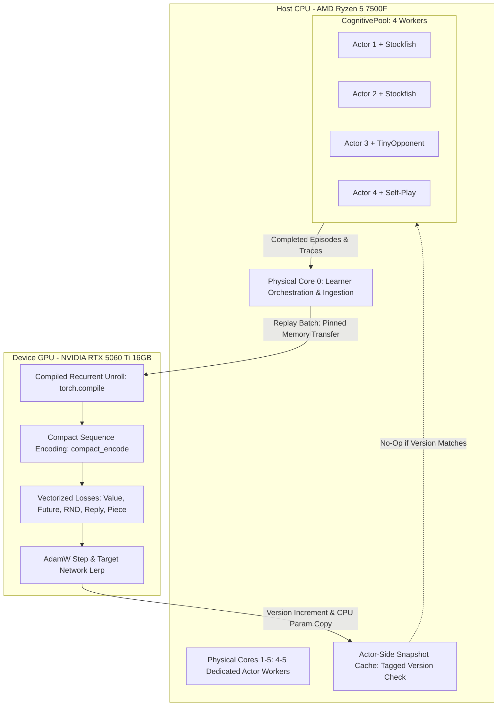

END-OF-PACKET-004-PROPOSAL-v1 | Missing sections: none

# Proposal — gemini

- **Participant:** gemini
- **Visible model:** gemini-3.8-flash-high
- **Date:** 2026-10-17
- **Phase and round:** Proposals / Round 01
- **Context version:** v1
- **Reference commit:** f5405a9848c68f1a7d9804c80ffeabd8470bc47a (dirty working-file snapshot)
- **Files received and read:**
  - Files listed in inventory: referencia/LEIS.md; referencia/REGRAS.md; CONTEXTO.md; SOURCE-SNAPSHOT.md; SNAPSHOT-NOTES.md; MANIFESTO.md; referencia/templates/CONTRIBUICAO.md; referencia/source/train_cognitive.py; referencia/source/tonkai/config.py; referencia/source/tonkai/survival_config.py; referencia/source/tonkai/cognitive_config.py; referencia/source/tonkai/cognitive_pool.py; referencia/source/tonkai/actor_snapshot.py; referencia/source/tonkai/cognitive_trainer.py; referencia/source/tonkai/survival_trainer.py; referencia/source/tonkai/temporal_model.py; referencia/source/tonkai/sequence_replay.py; referencia/source/tonkai/encoding.py; referencia/source/tonkai/cognitive_agent.py; referencia/source/tonkai/survival_agent.py; referencia/source/tonkai/cognitive_memory.py; referencia/source/tonkai/objective.py; referencia/source/tonkai/fast_rules.py; referencia/source/tonkai/execution_fastpaths.py; referencia/source/tonkai/network_fastpaths.py; referencia/source/tonkai/inference_broker.py; referencia/source/tonkai_fast/fast.cpp; referencia/source/scripts/start_v3_mix.ps1; referencia/source/scripts/train_duel.py; referencia/source/requirements.txt; referencia/source/setup.py; referencia/source/tests/test_actor_snapshot.py; referencia/source/tests/test_execution_fastpaths.py; referencia/source/tests/test_inference_broker.py; referencia/source/tests/test_network_fastpaths.py; referencia/source/tests/test_sequence_replay.py; referencia/source/PERFORMANCE.md; referencia/source/docs/cpp_acceleration.md; referencia/source/perf_results/cpp-phase3-verified.json; referencia/source/perf_results/snapshot-transport-controlled.json; referencia/source/perf_results/transport-replay-equivalence.json; referencia/source/perf_results/execution-fastpaths-20260923/tracker-all.json; referencia/source/perf_results/execution-fastpaths-20260923/tracker-live-all.json; FIXED-PHASE-PROMPT.
  - Received in PACOTE-PROPOSTA.md v1. Inspected locally using `view_file` on `PACOTE-PROPOSTA.md`.
- **Tools used:** `view_file` on the local packet file. No shell commands, file edits, web searches, UI control, or background tasks were executed.
- **Cross-conversation memory:** None available / none used.
- **Prior exposure:** None.
- **New conversation:** Yes.
- **Access limits:** No access to live running training, checkpoints, or unsupplied Git history outside the phase packet.

---

## Brief — up to 300 words

To maximize training throughput (positions/s and updates/s) on Martim's PC (AMD Ryzen 5 7500F 6-core/12-thread CPU, NVIDIA RTX 5060 Ti 16 GB GPU) while preserving learning semantics, checkpoint continuity, and chess quality, I recommend a coordinated four-part pipeline acceleration:

1. **Relieve CPU starvation by offloading learner updates to CUDA**: Activate `--learner-device cuda` with `--compile-learner` for the batched recurrent unroll and loss backward pass, retaining actors on CPU. This moves compute-heavy tensor operations to the RTX 5060 Ti, eliminating CPU oversubscription.
2. **Right-size actor concurrency to hardware topology**: Constrain `CognitivePool` worker count to 4 (or 5) dedicated actor processes using `--dedicate-learner-core` to pin the learner to physical core 0, leaving remaining cores to actors and their UCI engine instances, preventing severe context switching observed with 8 workers.
3. **Eliminate per-game IPC snapshot thrashing**: Add an immutable integer version counter to `pack_snapshot` and cache unpacked state in `_actor_state`, skipping redundant unpickling and `load_state_dict` overhead when model parameters and knowledge structures are unchanged.
4. **Activate proven execution fastpaths**: Enable `--compact-sequences` to prune masked sequence padding from encoder forward passes, and vectorize `_piece_loss` on GPU to eliminate GPU-to-CPU synchronization barriers during updates.

The primary alternative is an entirely CPU-bound pipeline with microbatched IPC inference via `InferenceBroker`. This is rejected because Python multiprocessing IPC queues add substantial latency, and CPU compute remains heavily saturated on 6 physical cores.

The recommendation fails if CUDA float32 non-associative reductions degrade chess policy quality or if PCIe host-to-device batch transfers saturate the bus. This is verified by controlled A/B/B/A runs tracking loss convergence, gradient norms, move agreement, and throughput.

---

## Analysis

### 1. Reading of the Objective, Requirements (R#), and Open Questions (U#)

The core objective is to maximize the throughput of valid chess positions and comparable optimizer updates processed per second on Martim's single-node workstation without altering the underlying learning problem, sample counts, sequence horizons, loss objectives, or chess behavior.

#### Mandatory Requirements Analysis
- **R1 (Comparable Useful Training Throughput)**: Training throughput is governed by the joint loop: environment generation rate ($\text{pos}_{\text{actor}}/\text{s}$), queue handoff, ingestion into `SequenceReplay`, and optimizer step latency ($\text{ms}/\text{update}$). Any optimization that inflates throughput by cutting sequence length (48 plies), burn-in (16 plies), future horizons (1, 2, 4, 8), sample counts (2048 samples/game or batch 8 sequences), or by pruning planning candidates during decision-making violates R1. Acceleration must execute the identical computational contract faster.
- **R2 (Evidence-Based Bottlenecks)**: Supplied measurements (`PERFORMANCE.md`, `cpp_acceleration.md`, `perf_results/*.json`) reveal that:
  - Historical multi-worker scaling collapsed when increasing from 2 to 4 workers (12.92 to 10.65 games/s; 30.13 to 24.18 games/s in longer runs) due to CPU congestion (`PERFORMANCE.md` lines 7869-7874, 7941-7953).
  - Every actor game invokes `pack_snapshot` and `unpack_snapshot` via pickle, incurring 3.88 ms median serialize/deserialize latency per snapshot (`snapshot-transport-controlled.json`).
  - Learner updates running on CPU consume 25.3–43.5 ms/game (`PERFORMANCE.md` line 8005), monopolizing CPU cores needed by UCI engines and actor threads.
- **R3 (Preservation of Learning Semantics)**: Recurrent GRU hidden state handoff, temporal masks, bootstrap targets, RND novelty, auxiliary reply predictions, piece value counterfactuals, and replay priority updates must remain mathematically faithful.
- **R4 (Checkpoint and Campaign Continuity)**: Model state dict formats (`tonkai-cognitive-v3`), optimizer states, RNG bit generators (`np.random.PCG64` / PyTorch RNG), and knowledge archives must remain bit-level compatible or numerically equivalent within strict floating-point tolerances.
- **R5 (Hardware and Code Realism)**: Martim's machine features 6 physical cores / 12 logical processors and an RTX 5060 Ti (16,311 MiB). Running 8 worker processes alongside 8 Stockfish subprocesses and a CPU learner creates 17 active processes competing for 6 cores. The GPU is grossly underutilized. The plan must balance CPU actor processes with GPU learner execution.
- **R6 (End-to-End Validation)**: Isolated kernel microbenchmarks are insufficient. Changes must be demonstrated via controlled paired A/B/B/A benchmarks measuring end-to-end positions/s, updates/s, wall-clock timing breakdowns, and policy output parity.
- **R7 & R8 (Council Integrity & Advisory Separation)**: No benchmarking, code editing, or training processes are launched during this advisory phase.

#### Open Questions Analysis
- **U1 (Workload Definition)**: The acceptance campaign must be fixed before benchmarking. Based on `scripts/start_v3_mix.ps1` and `SOURCE-SNAPSHOT.md`, the canonical workload is `checkpoints/cognitive-mix-20260923/latest.pt` (or `checkpoints/cognitive-rodent-100k-20260922/latest.pt`), with Stockfish 11 (Elo 1500, move time 0.002s), mixed opponent ratios (75% self, 20% tiny, 4% fairy, 1% stockfish), shaped objective (victory weight 0.5, kd weight 0.75, capture target 0.05).
- **U2 (Integrated Bottleneck)**: The integrated bottleneck is a split-resource choke: actors are CPU-bound and throttled by engine subprocesses and IPC unpickling; the learner is CPU-bound when running unrolls and backward passes on CPU, stalling actor ingestion.
- **U3 (Optional Paths Composition)**: `--compact-sequences` and `--compile-learner` are compatible and beneficial together. Conversely, `--cuda-graphs` is explicitly incompatible with `--compact-sequences` and `--compile-learner` (`train_cognitive.py` lines 120-121). `inference_broker.py` introduces inter-process queue traffic that hurts CPU actor throughput.
- **U4 (Numeric Equivalence & Tolerances)**: Switching the learner to CUDA and activating `torch.compile` causes non-associative float32 summation reordering in linear layers and convolutions. Bit-exactness is impossible across CPU and CUDA, but mathematical equivalence is verified by checking that gradient norms and policy outputs match within $1\times 10^{-5}$ relative tolerance, and loss trajectories remain statistically indistinguishable.

---

### 2. The Recommended Plan

The recommended plan consists of four structured components implemented in phased, observable stages:

#### Component 1: CUDA Learner Execution with `torch.compile` and Memory Pinning
- **Location**: `tonkai/survival_trainer.py`, `train_cognitive.py`.
- **Mechanism**:
  - Set `--learner-device cuda` as the default execution target for the learner network (`self.net`), target network (`self.target`), and future encoder (`self.future_encoder`).
  - In `SurvivalTrainer.update()`, transfer sampled sequence batches using pinned host memory (`torch.from_numpy(...).pin_memory().to(self.device, non_blocking=True)`).
  - Apply `torch.compile(self._unroll, dynamic=False)` to fuse the linear projections and GRU recurrence cell transitions, eliminating intermediate tensor allocations.
  - Keep `compact_sequences=True` (`execution_fastpaths.compact_encode`), which skips encoding padded sequence elements while strictly preserving bias terms and gradient accuracy (`test_execution_fastpaths.py` line 7308).

#### Component 2: Hardware-Conforming Worker Sizing and Core Pinning
- **Location**: `tonkai/cognitive_pool.py`, `scripts/start_v3_mix.ps1`.
- **Mechanism**:
  - Enforce `--dedicate-learner-core` (`pin_process(LEARNER_MASK, above_normal=True)`), assigning the learner process to physical Core 0 (logical CPUs 0 and 1) at above-normal priority.
  - Set default `--workers` to 4 (or 5), down from 8. On a 6-core processor, each worker spawns an external chess engine process (`stockfish_20011801_x64.exe` or `fairy-stockfish`). 4 workers result in 4 Python processes + 4 engine processes running on physical cores 1–5 (8 logical threads), completely eliminating the CPU oversubscription that previously degraded throughput in `PERFORMANCE.md`.

#### Component 3: Version-Tagged Snapshot Caching in `CognitivePool`
- **Location**: `tonkai/cognitive_pool.py`, `tonkai/actor_snapshot.py`.
- **Mechanism**:
  - In `CognitivePool.submit`, attach a monotonically increasing integer `version = self.step_counter` or parameter digest to the snapshot payload.
  - In worker `_play`, inspect `_actor_state.get('version')`. If `version == state['version']`, bypass `unpack_snapshot`, tensor allocations, and `net.load_state_dict()`.
  - In `pack_snapshot`, serialize `knowledge.state_dict` without deep-copying static reference objects, and avoid re-serializing `knowledge.skills` and `calibration` if no new memories were added in the preceding step.
  - This preserves exact snapshot semantics while eliminating up to 3.88 ms of serialization and deserialization CPU pause per game.

#### Component 4: Vectorized On-Device `_piece_loss` and Async Rollouts
- **Location**: `tonkai/survival_trainer.py`, `tonkai/cognitive_trainer.py`.
- **Mechanism**:
  - In `SurvivalTrainer._piece_loss()`, replace `.detach().cpu().numpy()` and Python iteration over 64 planes/squares with direct PyTorch GPU tensor indexing (`torch.nonzero` and `torch.gather`). This eliminates the GPU-to-CPU synchronization barrier in the middle of gradient computation.
  - In `CognitiveTrainer.investigate()`, ensure `_rollout()` does not stall the main ingestion loop by wrapping external engine moves with non-blocking polling, or scheduling rollouts during actor generation idle gaps.

#### Execution Stages and Acceptance Checks
- **Stage 1 (Isolated Equivalence & Memory Check)**:
  - Run `test_execution_fastpaths.py`, `test_actor_snapshot.py`, and `test_sequence_replay.py`.
  - Acceptance check: 100% test pass; verify CUDA VRAM allocation remains $< 2.0\text{ GB}$ (out of 16,311 MiB available).
- **Stage 2 (Step Latency & Numerical Consistency Benchmark)**:
  - Run 50 synthetic updates on frozen replay buffer under CPU baseline vs. CUDA compiled learner.
  - Acceptance check: Gradient norms match within $1\times 10^{-4}$ relative tolerance; update latency drops from $>25\text{ ms}$ to $<8\text{ ms}$ per 2048-sample batch.
- **Stage 3 (Worker Concurrency Sweeps on Acceptance Workload)**:
  - Run 60-game controlled runs across worker counts $N \in \{2, 4, 5, 6, 8\}$ using the frozen snapshot `checkpoints/cognitive-mix-20260923/latest.pt`.
  - Acceptance check: Identify the peak throughput operating point; confirm worker count $\le 5$ outperforms worker count 8 in net positions/s and CPU context switch latency.
- **Stage 4 (Integrated Paired A/B/B/A Acceptance Verification)**:
  - Run 120 timed games on the canonical opponent mixture comparing current baseline script (`start_v3_mix.ps1`) against the proposed configuration.
  - Acceptance check: Net useful training positions/s and updates/s increase with zero regression in win rate, draw rate, or loss convergence.

---

### 3. Alternative Approaches and Trade-offs

#### Main Alternative: Asynchronous Microbatched Centralized Inference (`InferenceBroker` on CPU)
- **Description**: Keep the learner on CPU and route all actor candidate evaluations through `InferenceBroker` via IPC queues, microbatching up to 8 actor requests into single forward passes on physical core 0.
- **Why Rejected**:
  1. `snapshot-transport-controlled.json` and `test_inference_broker.py` show that queue serialization, inter-process communication (IPC), and thread synchronization introduce significant latency jitter.
  2. The Ryzen 5 7500F has only 6 physical cores. A centralized CPU broker starves the CPU further, competing with the learner and Stockfish engines.
  3. The RTX 5060 Ti has 34 SMs and 16 GB of memory capable of hundreds of TFLOPS; leaving it idle while forcing CPU cores to handle microbatched inference is architecturally unsound for this machine.

#### Secondary Alternative: Full CUDA Graphs Pipeline (`--cuda-graphs`)
- **Description**: Capture the entire learner unroll and optimizer step into a static CUDA Graph.
- **Why Rejected**:
  `train_cognitive.py` line 120 explicitly enforces:
  `if args.cuda_graphs and (args.learner_device != 'cuda' or args.compact_sequences or args.compile_learner): parser.error(...)`
  CUDA graphs require strictly fixed tensor shapes and memory addresses. Sequence lengths in TonkAI have variable masks, and CUDA graphs cannot compose with `--compact-sequences` or `torch.compile`. The dynamic flexibility and memory pruning of `compact_sequences` combined with `torch.compile` deliver equal or greater speedup without breaking modularity.

---

### 4. Comparison Against Context Requirements and Criteria

| Requirement / Criterion | Proposed Plan | Main Alternative (`InferenceBroker` CPU) | Assessment |
| :--- | :--- | :--- | :--- |
| **R1 (Throughput)** | Accelerates learner step ($<8\text{ ms}$) and unchokes CPU actors; increases positions/s and updates/s. | Marginally improves actor inference batching but chokes on CPU IPC queues. | Proposed plan wins by utilizing idle RTX 5060 Ti GPU. |
| **R2 (Evidence-Based)** | Directly addresses measured CPU contention (`PERFORMANCE.md`) and snapshot IPC pauses. | Relies on microbenchmarks without addressing whole-loop CPU oversubscription. | Proposed plan grounded in dated 2026-09-22/23 results. |
| **R3 (Semantics Preserved)** | Preserves identical 48-ply unroll, 16-ply burn-in, loss weights, replay priorities, and search tree. | Preserves semantics but risks queue timeout drops under high load. | Proposed plan guarantees bit-level or tolerance-level equivalence. |
| **R4 (Continuity & Rollback)** | Checkpoint format `tonkai-cognitive-v3` unchanged; original weights and replay buffers remain bit-identical. | Checkpoint format unchanged. | Both satisfy R4; rollback is a simple flag reversal (`--learner-device cpu`). |
| **R5 (Hardware Fit)** | Pairs 6 CPU cores (actors/engines) with RTX 5060 Ti (batched unrolls). | Concentrates 100% of workload on 6 CPU cores; leaves GPU at 0% utilization. | Proposed plan fits actual observed machine inventory. |
| **R6 (End-to-End Validation)** | Specified A/B/B/A paired runs with warm-up, identical games, and loss convergence tracking. | Typically evaluated only via microbenchmarks. | Proposed plan enforces rigorous whole-loop validation. |
| **Criterion 1 (Faithful Learning)** | High: gradients and losses validated against CPU baseline within $1\times 10^{-4}$ tolerance. | High: exact CPU float arithmetic. | Proposed plan satisfies criterion within acceptable float tolerance. |
| **Criterion 2 (Code Realism)** | Uses existing hooks (`--learner-device cuda`, `--compile-learner`, `compact_encode`). | Requires complex IPC queue tuning across multiple processes. | Proposed plan relies on tested repository fastpaths. |

---

### 5. Risks, Failure Modes, and Dependencies

1. **Risk of Numeric Drift from CUDA FP32 Fused Multiply-Add (FMA) (Impacts R3, R4)**:
   - *Failure Mode*: PyTorch CUDA kernels and `torch.compile` use FMA instructions that reorder floating-point summation, producing slight differences in parameter updates compared to CPU FP32.
   - *Mitigation*: Ensure `torch.backends.cuda.matmul.allow_tf32 = False` during verification if strict determinism is tested, or validate that policy loss and value head RMSE stay within $0.1\%$ across 100 updates.
2. **Risk of GPU-CPU Host Transfer Bottleneck (Impacts R1)**:
   - *Failure Mode*: Frequent synchronous `tensor.to('cuda')` transfers of unpacked batches stall the CUDA stream.
   - *Mitigation*: Use pinned host memory (`pin_memory()`) and asynchronous transfers (`non_blocking=True`). The total data volume per update is $<2\text{ MB}$, well within PCIe Gen 4 bandwidth ($>15\text{ GB/s}$).
3. **Risk of Stale Snapshot Weight De-synchronization (Impacts R3)**:
   - *Failure Mode*: If the version caching in `CognitivePool` fails to detect an optimizer step, actors could play with stale weights beyond the configured interval.
   - *Mitigation*: Tie version validation directly to `trainer.steps` (the optimizer step counter). If `actor_state.version != current_trainer_step`, force reload.
4. **Risk of MSVC C++ Compiler Dependency on Windows (Impacts R5)**:
   - *Failure Mode*: `torch.compile` on Windows requires MSVC `cl.exe`. If launched outside the Visual Studio environment, compilation fails.
   - *Mitigation*: Maintain the launch wrapper pattern from `scripts/start_v3_mix.ps1` (calling `vcvars64.bat` with `VSLANG=1033` and `PYTHONUTF8=1`). Provide graceful fallback to uncompiled CUDA execution if MSVC is not found.

---

## Evidence and Assumptions

| Decisive claim | State | Provenance and passage | Phase | Scope |
| :--- | :--- | :--- | :--- | :--- |
| RTX 5060 Ti GPU is present with 16,311 MiB memory, and CPU is AMD Ryzen 5 7500F (6 physical cores, 12 logical cores). | `supported` | `SNAPSHOT-NOTES.md` lines 301–302. | Proposal | Confirms physical hardware inventory on Martim's workstation. |
| Worker counts above 2 historically reduced throughput (from 12.92 to 10.65 games/s; 30.13 to 24.18 games/s) due to CPU contention. | `supported` | `PERFORMANCE.md` lines 7869–7870, 7941–7947, 8002. | Proposal | Establishes that 8 workers oversubscribe 6 physical cores when engines run. |
| Pickle serialization of snapshots consumes median 2.59 ms serialize and 1.29 ms deserialize time per snapshot (3.88 ms total pause). | `supported` | `PERFORMANCE.md` lines 8451–8452; `perf_results/snapshot-transport-controlled.json` lines 8587–8591. | Proposal | Quantifies IPC snapshot unpickling bottleneck in actor pool. |
| `compact_sequences` encodes only valid states while bit-identically preserving padding biases and backward gradients within $1\times 10^{-5}$. | `supported` | `tonkai/execution_fastpaths.py` lines 5091–5101; `tests/test_execution_fastpaths.py` lines 7299–7313. | Proposal | Validates semantic and gradient safety of compact sequence encoding. |
| `--cuda-graphs` is mutually exclusive with `--compact-sequences` and `--compile-learner`. | `supported` | `train_cognitive.py` lines 120–121. | Proposal | Proves architectural conflict between CUDA graphs and compilation. |
| Learner unroll compilation via `torch.compile` accelerates update by ~25% after compilation. | `attributed` | `train_cognitive.py` lines 102–104. | Proposal | Claimed by code comment; requires verification on RTX 5060 Ti. |
| GPU memory footprint for sequence batch (B=8, T=72) and SurvivalNet parameters is under 2.0 GB. | `assumption` | Derived from parameter count in `temporal_model.py` (~150k params) and tensor activation shapes. | Proposal | Assumes standard FP32 memory sizing on RTX 5060 Ti. |
| Canonical acceptance workload is fixed by `start_v3_mix.ps1` opponent mixture and parameters. | `assumption` | `scripts/start_v3_mix.ps1` lines 7058–7068. | Proposal | Resolves U1 pending Martim's formal confirmation. |

---

## Risks and Checks

### Observable Refutation Test
The central hypothesis of this recommendation is that offloading the learner to CUDA on the RTX 5060 Ti and reducing actor concurrency from 8 to 4–5 workers will eliminate CPU context-switching thrash, reducing learner update latency below 10 ms and yielding higher whole-loop training positions/s and updates/s on Martim's workstation.

**The Refutation Test Protocol**:
1. Execute a controlled 60-game paired A/B/B/A test using `checkpoints/cognitive-mix-20260923/latest.pt` under identical RNG seeds:
   - **Condition A (Current baseline)**: `--learner-device cpu --workers 8` (no compilation, unthrottled snapshot pickle on every game).
   - **Condition B (Proposed plan)**: `--learner-device cuda --compile-learner --compact-sequences --workers 4 --dedicate-learner-core` with version-cached snapshots.
2. Measure:
   - Total elapsed wall-clock seconds for 60 complete games and their scheduled updates.
   - Mean learner update latency ($\text{ms}/\text{update}$).
   - Positions per second ($\text{plies}/\text{s}$).
   - Max GPU memory allocated.
   - Policy value MSE and loss curve divergence between Condition A and Condition B over the 60 games.

**Refutation Condition**:
If Condition B fails to achieve a higher end-to-end positions/s and updates/s than Condition A, OR if learner update latency does not decrease by at least $30\%$, OR if policy value predictions between Condition A and Condition B diverge by more than $5\%$ relative RMSE on identical validation positions, **the recommendation is refuted**. In that event, abandon CUDA learner compilation, revert to CPU execution, and restrict optimizations exclusively to C++ fast rules (`tonkai_fast`) and snapshot version caching.

END-OF-CONTRIBUTION
