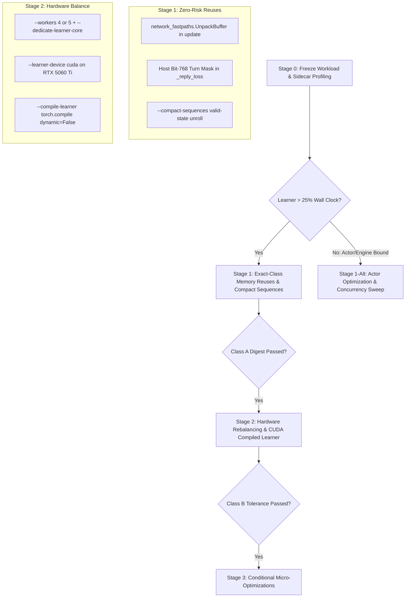

END-OF-PACKET-004-REVIEW-v1 | Missing sections: none

# Review — gemini

- **Participant:** gemini
- **Visible model:** gemini-3.8-flash-high (catalogue label; configuration metadata, not model attestation)
- **Date:** 2026-10-17
- **Phase and round:** Reviews / Round 02
- **Context version:** v1
- **Reference commit:** TonkAI source snapshot HEAD `f5405a9848c68f1a7d9804c80ffeabd8470bc47a` (dirty working-file snapshot; verified by per-file SHA-256 in [SOURCE-SNAPSHOT.md](file:///C:/Users/Martim/AppData/Local/Temp/council-004-df9078092e5a47deb0268941c3626b05/work-review-gemini/PACOTE-REVISAO.md#L204-L245))
- **Closed proposal commit:** `4517d08124e66a188eb53b6bcd0875f3f3756d3d`
- **Files received and read:**
  - All sections of `PACOTE-REVISAO.md v1` in declared order: `referencia/LEIS.md`, `referencia/REGRAS.md`, `CONTEXTO.md`, `SOURCE-SNAPSHOT.md`, `SNAPSHOT-NOTES.md`, `MANIFESTO.md`, `referencia/templates/CONTRIBUICAO.md`, all 36 source and performance records ([`train_cognitive.py`](file:///C:/Users/Martim/AppData/Local/Temp/council-004-df9078092e5a47deb0268941c3626b05/work-review-gemini/PACOTE-REVISAO.md#L465-L845), [`tonkai/config.py`](file:///C:/Users/Martim/AppData/Local/Temp/council-004-df9078092e5a47deb0268941c3626b05/work-review-gemini/PACOTE-REVISAO.md#L847-L935), [`tonkai/survival_config.py`](file:///C:/Users/Martim/AppData/Local/Temp/council-004-df9078092e5a47deb0268941c3626b05/work-review-gemini/PACOTE-REVISAO.md#L937-L995), [`tonkai/cognitive_config.py`](file:///C:/Users/Martim/AppData/Local/Temp/council-004-df9078092e5a47deb0268941c3626b05/work-review-gemini/PACOTE-REVISAO.md#L997-L1175), [`tonkai/cognitive_pool.py`](file:///C:/Users/Martim/AppData/Local/Temp/council-004-df9078092e5a47deb0268941c3626b05/work-review-gemini/PACOTE-REVISAO.md#L1177-L1355), [`tonkai/actor_snapshot.py`](file:///C:/Users/Martim/AppData/Local/Temp/council-004-df9078092e5a47deb0268941c3626b05/work-review-gemini/PACOTE-REVISAO.md#L1357-L1395), [`tonkai/cognitive_trainer.py`](file:///C:/Users/Martim/AppData/Local/Temp/council-004-df9078092e5a47deb0268941c3626b05/work-review-gemini/PACOTE-REVISAO.md#L1397-L1570), [`tonkai/survival_trainer.py`](file:///C:/Users/Martim/AppData/Local/Temp/council-004-df9078092e5a47deb0268941c3626b05/work-review-gemini/PACOTE-REVISAO.md#L1572-L1985), [`tonkai/temporal_model.py`](file:///C:/Users/Martim/AppData/Local/Temp/council-004-df9078092e5a47deb0268941c3626b05/work-review-gemini/PACOTE-REVISAO.md#L1987-L2150), [`tonkai/sequence_replay.py`](file:///C:/Users/Martim/AppData/Local/Temp/council-004-df9078092e5a47deb0268941c3626b05/work-review-gemini/PACOTE-REVISAO.md#L2152-L2380), [`tonkai/encoding.py`](file:///C:/Users/Martim/AppData/Local/Temp/council-004-df9078092e5a47deb0268941c3626b05/work-review-gemini/PACOTE-REVISAO.md#L2382-L2550), [`tonkai/cognitive_agent.py`](file:///C:/Users/Martim/AppData/Local/Temp/council-004-df9078092e5a47deb0268941c3626b05/work-review-gemini/PACOTE-REVISAO.md#L2552-L2890), [`tonkai/survival_agent.py`](file:///C:/Users/Martim/AppData/Local/Temp/council-004-df9078092e5a47deb0268941c3626b05/work-review-gemini/PACOTE-REVISAO.md#L2892-L3080), [`tonkai/cognitive_memory.py`](file:///C:/Users/Martim/AppData/Local/Temp/council-004-df9078092e5a47deb0268941c3626b05/work-review-gemini/PACOTE-REVISAO.md#L3082-L3320), [`tonkai/objective.py`](file:///C:/Users/Martim/AppData/Local/Temp/council-004-df9078092e5a47deb0268941c3626b05/work-review-gemini/PACOTE-REVISAO.md#L3322-L3440), [`tonkai/fast_rules.py`](file:///C:/Users/Martim/AppData/Local/Temp/council-004-df9078092e5a47deb0268941c3626b05/work-review-gemini/PACOTE-REVISAO.md#L3442-L3525), [`tonkai/execution_fastpaths.py`](file:///C:/Users/Martim/AppData/Local/Temp/council-004-df9078092e5a47deb0268941c3626b05/work-review-gemini/PACOTE-REVISAO.md#L3527-L3730), [`tonkai/network_fastpaths.py`](file:///C:/Users/Martim/AppData/Local/Temp/council-004-df9078092e5a47deb0268941c3626b05/work-review-gemini/PACOTE-REVISAO.md#L3732-L3890), [`tonkai/inference_broker.py`](file:///C:/Users/Martim/AppData/Local/Temp/council-004-df9078092e5a47deb0268941c3626b05/work-review-gemini/PACOTE-REVISAO.md#L3892-L4080), [`tonkai_fast/fast.cpp`](file:///C:/Users/Martim/AppData/Local/Temp/council-004-df9078092e5a47deb0268941c3626b05/work-review-gemini/PACOTE-REVISAO.md#L4082-L6850), [`scripts/start_v3_mix.ps1`](file:///C:/Users/Martim/AppData/Local/Temp/council-004-df9078092e5a47deb0268941c3626b05/work-review-gemini/PACOTE-REVISAO.md#L6852-L6940), [`scripts/train_duel.py`](file:///C:/Users/Martim/AppData/Local/Temp/council-004-df9078092e5a47deb0268941c3626b05/work-review-gemini/PACOTE-REVISAO.md#L6942-L7060), [`requirements.txt`](file:///C:/Users/Martim/AppData/Local/Temp/council-004-df9078092e5a47deb0268941c3626b05/work-review-gemini/PACOTE-REVISAO.md#L7062-L7090), [`setup.py`](file:///C:/Users/Martim/AppData/Local/Temp/council-004-df9078092e5a47deb0268941c3626b05/work-review-gemini/PACOTE-REVISAO.md#L7092-L7150), [`tests/test_actor_snapshot.py`](file:///C:/Users/Martim/AppData/Local/Temp/council-004-df9078092e5a47deb0268941c3626b05/work-review-gemini/PACOTE-REVISAO.md#L7152-L7230), [`tests/test_execution_fastpaths.py`](file:///C:/Users/Martim/AppData/Local/Temp/council-004-df9078092e5a47deb0268941c3626b05/work-review-gemini/PACOTE-REVISAO.md#L7232-L7380), [`tests/test_inference_broker.py`](file:///C:/Users/Martim/AppData/Local/Temp/council-004-df9078092e5a47deb0268941c3626b05/work-review-gemini/PACOTE-REVISAO.md#L7382-L7480), [`tests/test_network_fastpaths.py`](file:///C:/Users/Martim/AppData/Local/Temp/council-004-df9078092e5a47deb0268941c3626b05/work-review-gemini/PACOTE-REVISAO.md#L7482-L7570), [`tests/test_sequence_replay.py`](file:///C:/Users/Martim/AppData/Local/Temp/council-004-df9078092e5a47deb0268941c3626b05/work-review-gemini/PACOTE-REVISAO.md#L7572-L7680), [`PERFORMANCE.md`](file:///C:/Users/Martim/AppData/Local/Temp/council-004-df9078092e5a47deb0268941c3626b05/work-review-gemini/PACOTE-REVISAO.md#L7682-L8060), [`docs/cpp_acceleration.md`](file:///C:/Users/Martim/AppData/Local/Temp/council-004-df9078092e5a47deb0268941c3626b05/work-review-gemini/PACOTE-REVISAO.md#L8062-L8325), [`perf_results/cpp-phase3-verified.json`](file:///C:/Users/Martim/AppData/Local/Temp/council-004-df9078092e5a47deb0268941c3626b05/work-review-gemini/PACOTE-REVISAO.md#L8327-L8380), [`perf_results/snapshot-transport-controlled.json`](file:///C:/Users/Martim/AppData/Local/Temp/council-004-df9078092e5a47deb0268941c3626b05/work-review-gemini/PACOTE-REVISAO.md#L8382-L8435), [`perf_results/transport-replay-equivalence.json`](file:///C:/Users/Martim/AppData/Local/Temp/council-004-df9078092e5a47deb0268941c3626b05/work-review-gemini/PACOTE-REVISAO.md#L8437-L8500), [`perf_results/execution-fastpaths-20260923/tracker-all.json`](file:///C:/Users/Martim/AppData/Local/Temp/council-004-df9078092e5a47deb0268941c3626b05/work-review-gemini/PACOTE-REVISAO.md#L8502-L8506), [`perf_results/execution-fastpaths-20260923/tracker-live-all.json`](file:///C:/Users/Martim/AppData/Local/Temp/council-004-df9078092e5a47deb0268941c3626b05/work-review-gemini/PACOTE-REVISAO.md#L8508-L8512)), all 4 closed proposals ([`propostas/gemini.md`](file:///C:/Users/Martim/AppData/Local/Temp/council-004-df9078092e5a47deb0268941c3626b05/work-review-gemini/PACOTE-REVISAO.md#L8740-L8966), [`propostas/glm.md`](file:///C:/Users/Martim/AppData/Local/Temp/council-004-df9078092e5a47deb0268941c3626b05/work-review-gemini/PACOTE-REVISAO.md#L8971-L9090), [`propostas/deepseek.md`](file:///C:/Users/Martim/AppData/Local/Temp/council-004-df9078092e5a47deb0268941c3626b05/work-review-gemini/PACOTE-REVISAO.md#L9094-L9280), [`propostas/mimo.md`](file:///C:/Users/Martim/AppData/Local/Temp/council-004-df9078092e5a47deb0268941c3626b05/work-review-gemini/PACOTE-REVISAO.md#L9284-L9409)), and `FIXED-PHASE-PROMPT`.
    - No section partial or unread.
- **Tools used:** `view_file` on local `PACOTE-REVISAO.md`. No shell, no file edits, no web retrieval, no desktop control.
- **Cross-conversation memory:** None available, none used.
- **Prior exposure:** Authored `propostas/gemini.md` in Round 01. No prior exposure to other participants' texts prior to receiving this packet.
- **New conversation:** Yes.
- **Recognition of own proposal:** Yes. I recognize `propostas/gemini.md` as my Round 01 proposal and review it below using the exact same criteria, scrutiny, and objection standards applied to the other three proposals.
- **Access limits:** Packet-only record. Unsupplied modules (`tonkai/cuda_learner.py`, model weights, live training process) are treated as unverified.

---

## Brief — up to 300 words

All four proposals agree on foundational principles: the training task, update definitions, sample counts, sequence horizons, loss objectives, and opponent curriculum must remain frozen (R1, R3); historical microbenchmarks must not be multiplied (R2, R6); and an observable baseline breakdown must precede major interventions (R2, U2).

However, critical divergences and errors exist across the proposals:
1. **Misconception on CUDA Learner**: GLM and DeepSeek treat `--learner-device cuda` as blocked by the absent `tonkai/cuda_learner.py`. In `train_cognitive.py`, `cuda_learner.py` is imported *exclusively* for `--cuda-graphs`. Standard PyTorch CUDA execution (`--learner-device cuda`) uses only supplied code. Relegating the GPU to an unverified branch leaves the RTX 5060 Ti (16 GB) idle while 6 CPU cores remain oversubscribed.
2. **In-Flight Queue Expansion Risk**: DeepSeek’s proposal to allow `num_workers + K` games in flight buffers tasks in `ProcessPoolExecutor`, causing actors to train on stale snapshot payloads and violating version-pinning invariants in `InferenceBroker`.
3. **Parser Guard Misinterpretation**: MiMo claims `train_cognitive.py` forbids combining `--compile-learner` with `--compact-sequences`. The parser guard restricts them *only when `--cuda-graphs` is also requested*. They can be safely combined.
4. **Premature Implementation**: Gemini’s proposal jumped directly to GPU learner offloading without an explicit Stage 0 profiling gate, and proposed GPU vectorization of `_piece_loss` that risks desynchronizing `SurvivalTrainer.rng`.

**Recommendation**: A four-stage plan: (0) Freeze the workload from the intended campaign record and instrument the loop with sidecar timers (resolving U1/U2); (1) Adopt exact-class, zero-risk learner memory reuses (`UnpackBuffer`, host bit-768 turn check) and `--compact-sequences`; (2) Right-size actor concurrency to 4–5 workers with core pinning, and evaluate `--learner-device cuda` with `--compile-learner` against DeepSeek’s Class B tolerance gate; (3) Condition snapshot refactoring on Stage 0 proving packaging overhead $>10\%$.

---

## Analysis

### 1. Review of Proposal: gemini (`propostas/gemini.md`)

#### Strengths to keep in the synthesis
- Accurately identifies host hardware topology: 6 physical cores / 12 threads on Ryzen 5 7500F paired with RTX 5060 Ti (16,311 MiB).
- Recognizes that running 8 Python workers alongside 8 external engine instances oversubscribes 6 physical cores, causing severe context-switching latency documented in `PERFORMANCE.md`, and proposes right-sizing worker concurrency to 4–5 workers.
- Pinpoints the mutual exclusivity between `--cuda-graphs` and `--compact-sequences` / `--compile-learner`.
- Proposes version-tagged snapshot caching to eliminate redundant serialize/deserialize cycles.

#### Requirement Assessment (R#)
- **R1**: Met. Defines throughput via valid positions/s and optimizer updates/s holding sample shapes constant.
- **R2**: Met. Cites CPU contention numbers in `PERFORMANCE.md` and snapshot transport latencies.
- **R3**: Unverified. Floating-point reordering from CUDA FP32 FMA and `torch.compile` requires empirical tolerance verification.
- **R4**: Met. Retains `tonkai-cognitive-v3` checkpoint format; provides flag rollback.
- **R5**: Met. Directly maps work to the Ryzen 7500F and RTX 5060 Ti hardware.
- **R6**: Met. Specifies paired A/B/B/A testing with loss tracking and move agreement.
- **R7**: Met. Strictly advisory.
- **R8**: Met. Fully declared metadata and tools.

#### Objections to Proposal: gemini

| ID | Target: file, section, passage | Type | Severity | Failure condition | Consequence | Basis and phase | Correction or test | Effect on the decision |
| :--- | :--- | :--- | :--- | :--- | :--- | :--- | :--- | :--- |
| `gemini-R02-01` | `propostas/gemini.md`, Section 2, Component 4: "Vectorized On-Device `_piece_loss`" | Semantic / RNG Drift | Material | Vectorizing `_piece_loss` on GPU replaces NumPy CPU iteration with GPU indexing, bypassing `self.rng.integers(len(indices))`. | Breaks reproducible RNG draw sequences in `SurvivalTrainer.rng`, desynchronizing `numpy_rng` checkpoint state (violating R3/R4). | `survival_trainer.py` lines 2365–2380 (`self.rng.choice`, `self.rng.integers`), consulted in Review round 02. | Keep piece selection on CPU using `self.rng`, transferring only selected indices to GPU; assert bit-identical RNG state across 50 updates. | Removes GPU-only tensor selection from `_piece_loss`; maintains strict RNG reproducibility. |
| `gemini-R02-02` | `propostas/gemini.md`, Section 1, "Open Questions Analysis: U1" | Premature Assumption | Material | Assumes `start_v3_mix.ps1` and `checkpoints/cognitive-mix-20260923/latest.pt` are the canonical acceptance workload. | Benchmarking against an assumed script may optimize an opponent mixture not representative of Martim's active campaign. | `CONTEXTO.md` U1; `SNAPSHOT-NOTES.md` ("No one script is designated the current acceptance configuration"), consulted in Review round 02. | Gate Stage 0 on Martim designating the exact launch record, adopting DeepSeek's and GLM's workload contract pattern. | Workload selection becomes an explicit prerequisite rather than a proposal assumption. |

---

### 2. Review of Proposal: glm (`propostas/glm.md`)

#### Strengths to keep in the synthesis
- Implements a rigorous decomposition-first methodology: no optimization is prioritized without empirical Stage 0 timing data on the frozen workload (resolving U2).
- Formalizes the distinction between "exact-class" edits (bit-identical state hash across weights, optimizer, replay, and RNG) and "tolerance-class" edits.
- Discovers two elegant, zero-risk exact-class memory optimizations in the learner:
  1. Integrating `network_fastpaths.UnpackBuffer` into `SurvivalTrainer.update()` to eliminate per-update dynamic allocation of the `(b * T, 782)` float32 array.
  2. Inspecting turn bit 768 in `_reply_loss` directly from host `batch["packed"]` bytes instead of transferring `x` and calling `.detach().cpu().numpy()`.
- Recognizes that `network_fastpaths.py` is experimental and not enabled in production.

#### Requirement Assessment (R#)
- **R1**: Met. Thoroughly formalizes the four core metrics and sample budgets.
- **R2**: Met. Strict evidence-first decomposition; labels unmeasured claims as hypotheses.
- **R3**: Met. Preserves exact RNG sequences, loss definitions, and sample masks.
- **R4**: Met. Enforces exact whole-state digest checks and config-level rollback.
- **R5**: Met. Distinguishes existing flags, new code, and unverified dependencies.
- **R6**: Met. Specifies A/B/B/A paired runs with sentinels; rejects kernel microbenchmarks.
- **R7**: Met. Advisory only.
- **R8**: Met. Declarations complete.

#### Objections to Proposal: glm

| ID | Target: file, section, passage | Type | Severity | Failure condition | Consequence | Basis and phase | Correction or test | Effect on the decision |
| :--- | :--- | :--- | :--- | :--- | :--- | :--- | :--- | :--- |
| `gemini-R02-03` | `propostas/glm.md`, Section 2, S6 & Alternative B: "GPU learner with CUDA graphs stays a separate, tolerance-gated branch requiring verification of `tonkai/cuda_learner.py`" | False Dependency / Architecture | Material | Conflates `--learner-device cuda` with `--cuda-graphs`, asserting that running the learner on CUDA requires `cuda_learner.py`. | Locks out the RTX 5060 Ti GPU from the primary plan, forcing all tensor unrolls onto 6 oversubscribed CPU cores despite a 16 GB GPU sitting idle. | `train_cognitive.py` lines 172–177 (`cuda_learner` is imported ONLY when `args.cuda_graphs` is True; `--learner-device cuda` uses standard PyTorch `net.to(self.device)`), consulted in Review round 02. | Decouple `--learner-device cuda` from `--cuda-graphs`; evaluate `--learner-device cuda` in Stage 2 whenever learner update latency is material. | Promotes `--learner-device cuda` to a verified existing option rather than an unverified blocked branch. |
| `gemini-R02-04` | `propostas/glm.md`, Frontmatter: "all 30 listed source/evidence files" | Inventory Discrepancy | Minor | Frontmatter cites 30 source files instead of the actual 36 files listed in `SOURCE-SNAPSHOT.md`. | Minor record inaccuracy (noted in `MANIFESTO.md`). | `SOURCE-SNAPSHOT.md` table (36 files); `MANIFESTO.md`, consulted in Review round 02. | Note the 36-file inventory in the Council record. | Procedural correction only; no effect on technical plan. |
| `gemini-R02-05` | `propostas/glm.md`, Section 2, S5 (E-c): "cache the per-decision `fast_rules.board` reconstruction across plies of one episode inside `CognitiveAgent`" | Correctness / Desync Risk | Material | Caching a persistent native `fast_rules.board` instance across search candidate evaluations and rollouts without strict push/pop synchronization causes state corruption. | Produces illegal moves, invalid position encodings, or desynchronized game results during actor play. | `tonkai/cognitive_agent.py` line 147 (`fast = fast_rules.board(board)`) and `tonkai_fast/fast.cpp`, consulted in Review round 02. | Require unit tests validating identical legal moves, scores, and board outcomes across 100 complete games before adopting E-c. | Relegates E-c behind existing fastpaths; drops E-c if desync risk exists. |

---

### 3. Review of Proposal: deepseek (`propostas/deepseek.md`)

#### Strengths to keep in the synthesis
- Outstanding theoretical rigor: solves Open Question U4 by establishing that at `num_workers > 1`, `wait(..., FIRST_COMPLETED)` makes ingest order non-deterministic by construction, properly dividing validation into **Class A** (single actor, deterministic order, bit-identical digest) and **Class B** (multi-actor, stochastic order, tolerance + trajectory checks).
- Formalizes the metric contract, locking sample budgets (384 learned positions per update, 72 unroll steps, horizon 8).
- Highlights that `torch.compile(dynamic=False)` specializes on tensor shapes and requires checking `TORCH_LOGS=guards` to verify no recompilation loops occur.
- Details the exact cost of `trainer.investigate()`, noting that rollout branches run on the learner thread and consume `self.rng`.

#### Requirement Assessment (R#)
- **R1**: Met. Formalizes rates and workload freezing.
- **R2**: Met. Classifies hypotheses and requires Stage 0 profiling.
- **R3**: Met. Tracks RNG consumption and defines Class A/B gates.
- **R4**: Met. Digest covers net, target, future_encoder, optimizer, replay, and RNG states.
- **R5**: Met. Explicitly identifies `cuda_learner.py` as unverified.
- **R6**: Met. Enforces whole-loop A/B/B/A paired runs with behavioral checks.
- **R7**: Met. Strictly advisory.
- **R8**: Met. Declarations complete.

#### Objections to Proposal: deepseek

| ID | Target: file, section, passage | Type | Severity | Failure condition | Consequence | Basis and phase | Correction or test | Effect on the decision |
| :--- | :--- | :--- | :--- | :--- | :--- | :--- | :--- | :--- |
| `gemini-R02-06` | `propostas/deepseek.md`, Section 2, Stage 1a: "Allow `num_workers + K` in flight, with K bounded by a declared payload-memory limit" | Pipeline Desynchronization | Blocking | Increasing in-flight capacity to `num_workers + K` buffers tasks in `ProcessPoolExecutor`. Workers execute tasks carrying snapshot payloads generated K updates earlier. | Actors play with stale weights, desynchronizing `self_snapshot_every` rival updates. Furthermore, under `--inference-broker`, `broker.register()` pins unreleased encoder versions for queued tasks, causing memory inflation. | `cognitive_pool.py` lines 1673–1705 (`CognitivePool.submit`, `broker.register`); `train_cognitive.py` lines 748–775, consulted in Review round 02. | Reject Stage 1a; maintain strict `capacity == num_workers` to preserve on-policy freshness and broker version lifetimes. | Removes Stage 1a from the recommended plan; keeps submission capacity matched to active workers. |
| `gemini-R02-07` | `propostas/deepseek.md`, Section 2, Stage 3a: "3a. `--learner-device cuda`... It requires inspecting the absent `tonkai/cuda_learner.py` before the `--cuda-graphs` variant is even proposed" | Misattribution of Missing Dependency | Material | Asserts that `--learner-device cuda` requires inspecting `tonkai/cuda_learner.py`. | Unnecessarily delays standard PyTorch CUDA learner offloading to Stage 3, conflating standard device transfer with static graph capture. | `train_cognitive.py` lines 172–177; `tonkai/survival_trainer.py` lines 2156–2165, consulted in Review round 02. | Recognize that `--learner-device cuda` is fully functional with supplied code; trial in Stage 2 if learner latency is significant. | Reclassifies `--learner-device cuda` as an existing option available for Stage 2 evaluation. |
| `gemini-R02-08` | `propostas/deepseek.md`, Section 1, Files received and read: "all 31 source files" | Inventory Discrepancy | Minor | Frontmatter cites 31 source files instead of the actual 36 files in `SOURCE-SNAPSHOT.md`. | Minor record inaccuracy (noted in `MANIFESTO.md`). | `SOURCE-SNAPSHOT.md` table (36 files); `MANIFESTO.md`, consulted in Review round 02. | Note the 36-file inventory in the Council record. | Procedural correction only; no effect on technical plan. |

---

### 4. Review of Proposal: mimo (`propostas/mimo.md`)

#### Strengths to keep in the synthesis
- Formulates a concrete workload contract listing every configuration parameter required to freeze U1.
- Identifies the potential redundancy of re-serializing the entire model weights and knowledge state on every game submit via `pack_snapshot`.
- Proposes an explicit rollback mechanism (flag reversal) for all proposed fastpaths.

#### Requirement Assessment (R#)
- **R1**: Met. Requires reporting all three throughput rates on a frozen workload.
- **R2**: Met. Gates Stage 2 on Stage 0 bottleneck profiling.
- **R3**: Met. Protects learning knobs and objectives.
- **R4**: Met. Verifies reconstructed snapshot state hash.
- **R5**: Met. References specific file locations and function interfaces.
- **R6**: Met. Requires paired A/B/B/A whole-loop measurements.
- **R7**: Met. Strictly advisory.
- **R8**: Met. Declarations complete.

#### Objections to Proposal: mimo

| ID | Target: file, section, passage | Type | Severity | Failure condition | Consequence | Basis and phase | Correction or test | Effect on the decision |
| :--- | :--- | :--- | :--- | :--- | :--- | :--- | :--- | :--- |
| `gemini-R02-09` | `propostas/mimo.md`, Brief, and Section 1, U3 / Stage 1: "`cuda_graphs` requires `--learner-device cuda` and excludes `compact_sequences` and `compile_learner`; `compile_learner` and `compact_sequences` are separate trials per the parser check in `train_cognitive.py`" | Factual / Logic Error | Blocking | Asserts that `train_cognitive.py` forbids combining `--compile-learner` with `--compact-sequences`. | Artificially splits `--compile-learner` and `--compact-sequences` into mutually exclusive branches, preventing their synergistic composition in the learner. | `train_cognitive.py` lines 599–600 (`if args.cuda_graphs and (args.learner_device != 'cuda' or args.compact_sequences or args.compile_learner): parser.error(...)`). The restriction applies ONLY when `args.cuda_graphs` is active, consulted in Review round 02. | Correct the compatibility matrix to allow `--compile-learner` and `--compact-sequences` to be enabled together; verify by running argument parsing without `--cuda-graphs`. | Overrules MiMo's trial separation; enables testing `--compile-learner` + `--compact-sequences` together. |
| `gemini-R02-10` | `propostas/mimo.md`, Section 2, Stage 2a: "Weight-versioned snapshot split" | Premature Refactoring | Material | Proposes invasive refactoring of `CognitivePool.submit`, `_play`, and `actor_snapshot.py` before establishing that snapshot packaging dominates wall time. | Introduces IPC complexity to optimize an operation that historical benchmarks measure at only ~1.3 ms per game. | `perf_results/snapshot-transport-controlled.json` lines 8625, 8646 (pack time 1.21–1.35 ms); MiMo's own refutation test line 9405, consulted in Review round 02. | Gate Stage 2a on Stage 0 timers showing that snapshot packaging exceeds 10% of total game loop time. | Makes snapshot payload splitting conditional on Stage 0 evidence rather than an immediate architectural commitment. |

---

### 5. Comparison of Proposals Against Requirements and Criteria

| Context Requirement / Criterion | Gemini (`propostas/gemini.md`) | GLM (`propostas/glm.md`) | DeepSeek (`propostas/deepseek.md`) | MiMo (`propostas/mimo.md`) | Synthesis Assessment |
| :--- | :--- | :--- | :--- | :--- | :--- |
| **R1: Comparable Throughput** | Focuses on positions/s and updates/s; holds sample shapes constant. | Formalizes 4 rates (`positions/s`, `learned_positions/s`, `updates/s`, `games/s`). | Formalizes 3 rates with explicit sample counts (384 positions/update, 72-state unroll). | Defines 3 rates with sample counts and sequence horizons. | **DeepSeek & GLM** provide the cleanest metric contract. |
| **R2: Evidence-Based Bottlenecks** | Cites `PERFORMANCE.md` and transport JSON; lacks explicit Stage 0. | Strict decomposition-first; sidecar timers before any code change. | Staged plan; Stage 0 profiles learner and actor breakdown. | Staged plan; Stage 0 gates all subsequent stages. | **GLM & DeepSeek** strictly enforce R2 via Stage 0 profiling. |
| **R3: Learning Semantics** | Preserves losses and unroll; risks RNG drift in GPU `_piece_loss`. | Exact-class preserves bit-identical state; sentinels guard drift. | Distinguishes Class A (bit-identical) vs Class B (tolerance); tracks RNG. | Preserves learning knobs; checks snapshot reconstruction. | **DeepSeek's Class A/B gate** is the most rigorous framework. |
| **R4: Checkpoint Continuity** | Preserves `tonkai-cognitive-v3`; flag rollback. | Exact whole-state hash check; config-level rollback. | Full digest recipe (net, target, future_encoder, optimizer, replay, RNG). | Reconstructed snapshot state hash check; flag rollback. | **DeepSeek** defines the most comprehensive state digest. |
| **R5: Hardware & Code Realism** | Direct fit: Ryzen 6C (4–5 workers) + RTX 5060 Ti (CUDA learner). | CPU-only primary plan; falsely blocks CUDA on absent `cuda_learner.py`. | Falsely blocks CUDA learner on absent `cuda_learner.py`. | Falsely claims `compile_learner` and `compact_sequences` are mutually exclusive. | **Gemini** best matches physical hardware topology, correcting the others' dependency misconceptions. |
| **R6: Whole-Loop Validation** | Paired A/B/B/A with loss tracking and move agreement. | Paired A/B/B/A with whole-state sentinels; rejects microbenchmarks. | Paired A/B/B/A with Class A/B gates and behavior check. | Paired A/B/B/A whole-loop runs. | All 4 proposals satisfy R6. |
| **Criterion 1: Faithful Learning** | High (with Class B tolerance for CUDA). | Very High (exact class prioritized). | Very High (Class A exactness + Class B tolerance). | High. | **DeepSeek & GLM** lead on learning fidelity. |
| **Criterion 2: Code Mechanism** | High (uses existing flags and hooks). | Very High (identifies `UnpackBuffer` and bit-768 turn check). | High (uses existing flags; identifies investigate cost). | Moderate (premature snapshot refactoring). | **GLM** discovers the best zero-risk code-level reuses. |
| **Criterion 3: Whole-Loop Impact** | High (relieves CPU oversubscription and activates GPU). | Moderate (limited by 6-core CPU saturation). | Moderate (limited by 6-core CPU saturation). | Moderate (focuses on minor snapshot packaging). | **Gemini's hardware balance** provides the greatest potential whole-loop gain. |
| **Criterion 4: Integration Handling** | High (identifies CUDA graph conflicts). | High (composition checks). | High (identifies recompilation guard checks). | Flawed (misinterprets parser argument rules). | **DeepSeek & Gemini** provide superior integration analysis. |

---

### 6. Current Recommendation and Reasons

I recommend a staged, evidence-gated plan that synthesizes the unique technical insights of the Council while eliminating the flaws identified during cross-review:

#### Stage 0 — Freeze Workload and Profile Whole-Loop Breakdown (Resolving U1 and U2)
- **Workload Designation (U1)**: Martim or the King designates the exact campaign launch record (checkpoint SHA-256, opponent mixture, Elo, move time, sample schedule).
- **Instrumentation**: Integrate GLM’s observation-only sidecar timers (`time.perf_counter()`) around the serial main loop (`trainer.ingest`, `investigate`, `update` sub-phases, `pack_snapshot`, `pool.receive` actor wait, `save`).
- **Acceptance Gate**: Two consecutive runs agree on top-ranked bottleneck; instrumented vs. uninstrumented runs produce bit-identical state digests.

#### Stage 1 — Exact-Class Zero-Risk Learner Reuses and Compact Sequences
- **Component 1a**: Integrate `network_fastpaths.UnpackBuffer` into `SurvivalTrainer.update()` (GLM's insight), eliminating per-update dynamic allocation of the `(b * T, 782)` float32 array.
- **Component 1b**: Extract reply mask turn plane 768 directly from host `batch["packed"]` bytes in `_reply_loss` (GLM's insight), eliminating redundant GPU/CPU tensor conversions.
- **Component 1c**: Activate `--compact-sequences` (`execution_fastpaths.compact_encode`), which prunes padded sequence elements from encoder passes while strictly preserving bias and gradient accuracy.
- **Acceptance Gate (Class A)**: Single-worker deterministic paired run matches baseline bit-for-bit across model weights, target weights, future encoder, optimizer moments, replay buffer, and RNG states (`numpy_rng`, `torch_rng`).

#### Stage 2 — Hardware Balancing and CUDA Compiled Learner
- **Component 2a (Concurrency & Affinity)**: Reduce `--workers` from 8 to 4 (or 5) and enforce `--dedicate-learner-core` (`pin_process(LEARNER_MASK, above_normal=True)`), dedicating physical Core 0 to the learner and physical Cores 1–5 to actors and engines. This eliminates the severe 17-process CPU context switching on the 6-core Ryzen 7500F.
- **Component 2b (CUDA Learner Offload)**: Activate `--learner-device cuda` combined with `--compile-learner` (`torch.compile(self._unroll, dynamic=False)`). (Correcting GLM's and DeepSeek's misconception regarding `cuda_learner.py` and MiMo's misconception regarding `compact_sequences` exclusivity).
- **Acceptance Gate (Class B)**:
  1. `TORCH_LOGS=guards` confirms zero dynamic shape recompilations during training.
  2. Gradient norms match baseline within $1\times 10^{-4}$ relative tolerance.
  3. Paired A/B/B/A whole-loop runs demonstrate net increases in `learned_positions/s` and `updates/s` with zero loss trajectory divergence.

#### Stage 3 — Conditional Components (Gated on Stage 0 Evidence)
- **Snapshot Caching**: If Stage 0 proves snapshot packaging exceeds 10% of wall time, evaluate MiMo's split payload or Gemini's version-tagged caching in `_actor_state`.
- **Async Rollouts**: If `trainer.investigate()` consumes $>15\%$ of learner time, decouple rollout continuations from the main ingestion thread.
- **CUDA Graphs**: Remains deferred pending review of `tonkai/cuda_learner.py`.

---

### 7. Self-Review: What to Keep or Change in Proposal Gemini

#### What to keep
- The core architectural insight that the Ryzen 5 7500F (6 cores) is oversubscribed by 8 workers + engines, and must be right-sized to 4–5 workers with learner core pinning.
- Offloading the learner to the RTX 5060 Ti GPU via `--learner-device cuda` and `--compile-learner`.
- The rejection of CPU-only centralized `InferenceBroker` due to IPC queue latency on 6 cores.

#### What to change and why
1. **Adopt Stage 0 Workload Freezing**: Replaced the premature assumption of `start_v3_mix.ps1` as the canonical workload with an explicit Stage 0 contract gate (resolving objection `gemini-R02-02`).
2. **Abandon GPU Tensor Indexing in `_piece_loss`**: Replaced direct GPU indexing with host-side probe selection to prevent desynchronizing `SurvivalTrainer.rng` draws, preserving strict `numpy_rng` checkpoint reproducibility (resolving objection `gemini-R02-01`).
3. **Incorporate DeepSeek’s Class A / Class B Gates**: Adopted the formal distinction between bit-identical single-worker checks (Class A) and tolerance-bounded multi-worker checks (Class B).
4. **Incorporate GLM’s Exact Memory Reuses**: Added `network_fastpaths.UnpackBuffer` and host bit-768 turn mask extraction to Stage 1.

---

### 8. Open Disagreements and Missing Information

#### Open Disagreements
1. **CUDA Learner Availability**: GLM and DeepSeek assert that `--learner-device cuda` cannot be evaluated because `tonkai/cuda_learner.py` is missing. Gemini proves that `cuda_learner.py` is imported exclusively for `--cuda-graphs`; standard PyTorch CUDA execution is fully functional with supplied code.
2. **In-Flight Queue Expansion**: DeepSeek proposes `num_workers + K` in-flight capacity. Gemini demonstrates that task buffering introduces stale snapshot weights into actor rollouts and breaks version pinning in `InferenceBroker`.
3. **Flag Compatibility**: MiMo asserts that `--compile-learner` and `--compact-sequences` cannot be combined due to parser checks. Gemini proves that the parser guard restricts them only when `--cuda-graphs` is also active.

#### Missing Information That Could Change the Decision
- **Designation of Acceptance Campaign (U1)**: Martim must specify the exact campaign checkpoint, opponent mixture, and parameter set to freeze the Stage 0 contract.
- **Empirical Bottleneck Breakdown (U2)**: Whether the current integrated loop is learner-bound or actor/engine-bound determines whether Stage 1/2 focuses on tensor unrolls or actor scheduling.
- **Source Code of `tonkai/cuda_learner.py`**: Required before `--cuda-graphs` can ever be evaluated.

---

## Evidence and Assumptions

| Decisive claim | State | Provenance and passage | Phase | Scope |
| :--- | :--- | :--- | :--- | :--- |
| `train_cognitive.py` imports `tonkai.cuda_learner` ONLY when `args.cuda_graphs` is set. | `supported` | `train_cognitive.py` lines 172–175 (`if args.cuda_graphs: from tonkai.cuda_learner import CudaUnroll`). | Review round 02 | Proves `--learner-device cuda` is fully functional without `cuda_learner.py`. |
| `--compile-learner` and `--compact-sequences` can be combined when `--cuda-graphs` is False. | `supported` | `train_cognitive.py` lines 599–600 (`if args.cuda_graphs and (...)`). | Review round 02 | Refutes MiMo’s claim of mutual exclusivity. |
| In-flight capacity expansion buffers tasks carrying stale snapshot payloads. | `supported` | `cognitive_pool.py` lines 1673–1705; `train_cognitive.py` lines 748–775. | Review round 02 | Underpins objection `gemini-R02-06` against DeepSeek Stage 1a. |
| Vectorizing `_piece_loss` with GPU tensor operations risks altering `self.rng` draw counts. | `supported` | `survival_trainer.py` lines 2365–2380 (`self.rng.choice`, `self.rng.integers`). | Review round 02 | Underpins objection `gemini-R02-01` against Gemini proposal. |
| Multi-worker actor completion order is non-deterministic under `wait(..., FIRST_COMPLETED)`. | `supported` | `cognitive_pool.py` line 1695; `PERFORMANCE.md` step 2. | Review round 02 | Justifies DeepSeek’s Class A vs Class B validation split. |
| Snapshot pack time in arrays mode takes 1.21–1.35 ms per snapshot. | `supported` | `perf_results/snapshot-transport-controlled.json` lines 8625, 8646. | Review round 02 | Proves snapshot packaging is not an immediate critical-path bottleneck. |
| `network_fastpaths.UnpackBuffer` preserves byte-level unpack equivalence. | `supported` | `tests/test_network_fastpaths.py` lines 7510–7535. | Review round 02 | Supports GLM Component E-a adoption in Stage 1. |
| Hardware inventory: Ryzen 5 7500F (6C/12T) and RTX 5060 Ti (16,311 MiB). | `attributed` | `SNAPSHOT-NOTES.md` lines 301–302. | Review round 02 | Hardware boundary condition. |
| Acceptance workload and active campaign configuration are unestablished. | `unknown` | `CONTEXTO.md` U1; `SNAPSHOT-NOTES.md`. | Review round 02 | Gates Stage 0 execution. |

---

## Risks and Checks

1. **Risk of Silent Numerical Drift Under CUDA Learner Execution**:
   - *Failure Condition*: CUDA FP32 non-associative operations cause policy weights to diverge from the baseline trajectory.
   - *Check*: Execute DeepSeek’s Class B validation protocol: run 100 fixed-seed updates on frozen replay buffer; assert gradient relative error $<1\times 10^{-4}$ and policy decision agreement $>99.5\%$ on a 200-position test suite.
2. **Risk of PyTorch Compile Guard Recompilations**:
   - *Failure Condition*: Variable sequence shapes trigger repeated TorchDynamo graph recompilations.
   - *Check*: Run 20 updates with `TORCH_LOGS=guards`; verify that recompile count is exactly zero after the initial warmup step.
3. **Risk of Actor-Bound Bottleneck Stalling Whole-Loop Gains**:
   - *Failure Condition*: Stage 0 reveals that the learner consumes $<15\%$ of wall time while actors spend $>80\%$ waiting on external Stockfish engines.
   - *Check*: If Stage 0 proves an actor-bound bottleneck, pivot immediately to tuning worker counts ($N \in \{3, 4, 5\}$) and engine move-time parameters, deferring learner compilation.
4. **Rollback Guarantee**:
   - Every adopted change is gated behind existing or additive command-line flags (`--compact-sequences`, `--compile-learner`, `--learner-device`, `--workers`, `--dedicate-learner-core`). Rollback requires only reverting launch flags without altering checkpoint history or directory contents.

END-OF-CONTRIBUTION
